# RT Helpdesk — DevOps Final Project

Production-style DevOps deployment and operations for the **RT Helpdesk** Flask + PostgreSQL application on **AWS (`eu-north-1`)**, covering Docker multi-stage packaging, Git/GitHub Actions CI, Terraform IaC with remote S3 state, Linux hardening, Kubernetes (`kind`), Jenkins CI/CD with rollback, Prometheus & Grafana monitoring, and S3 disaster recovery.

> **Reuse & Custom Changes Disclosure:** The Flask application (`app/`), database schema, automated test suite (`tests/`), Compose baseline, helper scripts, and `reference/` infrastructure templates were supplied in the student starter package. I authored `Dockerfile` and `.dockerignore` from scratch, fixed `postgres/init/01-app-role.sh` executable permissions (`0755`), strengthened `.gitignore`, configured GitHub Actions CI with Terraform formatting/validation and branch protection, fixed `reference/linux/bootstrap-ubuntu.sh` for Ubuntu 24.04 AWS CLI v2 installation, adapted Terraform variables for AWS Free Plan (`eu-north-1`, `c7i-flex.large` / `m7i-flex.large`, `$50` monthly budget), configured `reference/Jenkinsfile` for `ghcr.io/sarelgrin-web/rt-helpdesk` and private `APP_HOST`, configured private GHCR pulling via `ghcr-pull-secret`, and added a self-study P95 latency panel to `reference/k8s/helpdesk-dashboard.json`.

---

## Architecture

```mermaid
flowchart LR
  User["Admin Workstation<br/>SSH Tunnels + port-forward<br/>IP: 5.29.16.5/32"]
  GH["GitHub + Actions<br/>sarelgrin-web/rt-helpdesk"]
  GHCR["GitHub Container Registry<br/>ghcr.io/sarelgrin-web/rt-helpdesk"]
  S3State["S3 State Bucket (Private)<br/>rt-helpdesk-tfstate-171014298311"]
  S3Backup["S3 Backup Bucket (Private)<br/>rt-helpdesk-backups-171014298311"]

  subgraph VPC["AWS VPC 10.42.0.0/16 (eu-north-1, Public Subnet 10.42.1.0/24)"]
    subgraph CI["CI Host (c7i-flex.large, 10.42.1.235)"]
      Jenkins["Jenkins LTS 2.580.2<br/>0 controller executors"]
      Agent["SSH Agent: helpdesk-build<br/>user: buildagent (docker)"]
    end

    subgraph APP["App Host (m7i-flex.large, 10.42.1.80)"]
      subgraph K8S["kind Kubernetes v1.37.0"]
        subgraph NSApp["Namespace: helpdesk"]
          API["Deployment/api (1 replica)<br/>UID 10001, read-only rootfs"]
          DB["StatefulSet/db<br/>PostgreSQL 16 + 2Gi PVC"]
        end
        subgraph NSMon["Namespace: monitoring"]
          Prom["Prometheus v3.16.0<br/>Pod SD + DB Alert"]
          Graf["Grafana 13.3.0<br/>4 Provisioned Panels"]
        end
      end
    end
  end

  User -- "SSH :22 (admin CIDR only)" --> CI
  User -- "SSH :22 (admin CIDR only)" --> APP
  GH --> Jenkins
  Jenkins --> Agent
  Agent -- "Build & Push Digest" --> GHCR
  Agent -- "SSH :22 as deploy (private IP)" --> APP
  API --> DB
  Prom -- "Scrape :8000/metrics" --> API
  Graf --> Prom
  APP -- "IAM Instance Role (Put/Get/List)" --> S3Backup
  User -. "Terraform Remote State" .-> S3State
```



**Known Lab Limitations:** A single EC2 App host and single PostgreSQL StatefulSet replica do not provide high availability. `kind`'s `rancher.io/local-path` PVC is tied to the host disk and does not survive deleting the `kind` cluster or EC2 host — S3 `pg_dump` backups mitigate data loss. Co-locating monitoring on the App host means a host failure takes down both the app and monitoring.

---

## Port & Access Table

No application, database, Jenkins, Grafana, Prometheus, or Kubernetes API ports are exposed publicly. All web UIs are accessed through localhost-bound SSH tunnels and `kubectl port-forward`.

| Service | Host / Namespace | Internal Port | Access Method |
|---|---|---:|---|
| SSH (Admin) | CI (`13.62.127.149`) & App (`13.61.0.237`) | 22 | Restricted to admin IP (`5.29.16.5/32`) via AWS Security Groups |
| SSH (Deploy) | CI → App (`10.42.1.80`) | 22 | Private VPC SG rule (`sg-ci` → `sg-app`), `deploy` user, verified `known_hosts` |
| Jenkins UI | CI Host (`127.0.0.1:8080`) | 8080 | `ssh -i ~/.ssh/rt-helpdesk-lab -L 8080:127.0.0.1:8080 ubuntu@13.62.127.149` |
| Helpdesk UI / API | App Host (`helpdesk/svc/api`) | 8000 | App: `kubectl -n helpdesk port-forward svc/api 8000:8000`<br/>Local: `ssh -i ~/.ssh/rt-helpdesk-lab -L 8000:127.0.0.1:8000 ubuntu@13.61.0.237` |
| Prometheus | App Host (`monitoring/svc/prometheus`) | 9090 | App: `kubectl -n monitoring port-forward svc/prometheus 9090:9090`<br/>Local: `ssh -i ~/.ssh/rt-helpdesk-lab -L 9090:127.0.0.1:9090 ubuntu@13.61.0.237` |
| Grafana | App Host (`monitoring/svc/grafana`) | 3000 | App: `kubectl -n monitoring port-forward svc/grafana 3000:3000`<br/>Local: `ssh -i ~/.ssh/rt-helpdesk-lab -L 3000:127.0.0.1:3000 ubuntu@13.61.0.237` |
| PostgreSQL | App Host (`helpdesk/svc/db`) | 5432 | Cluster-internal headless Service only (not exposed externally) |

---

## 1. Container Packaging & Local Operation (Milestone 1)

### Dockerfile & `.dockerignore` Design
- **Build stages (`Dockerfile`):**
  - `base` (`python:3.12-slim-bookworm`): sets `PYTHONDONTWRITEBYTECODE=1` and `PYTHONUNBUFFERED=1`, creates non-root user/group `helpdesk` (`10001:10001`), installs runtime dependencies from `requirements.txt`, then copies `gunicorn.conf.py` and `app/`.
  - `test` (extends `base`): installs `requirements-dev.txt`, copies `pytest.ini` and `tests/`, switches to `USER 10001:10001`, and defaults to `python -m pytest -q -p no:cacheprovider`.
  - `runtime` (final/default stage, extends `base`): placed **last** so `docker build .` without `--target` builds the production web image (never `test`). Declares `ARG APP_VERSION=local` / `ENV APP_VERSION=${APP_VERSION}`, `EXPOSE 8000`, `USER 10001:10001`, and JSON exec-form `CMD ["gunicorn", "--config", "gunicorn.conf.py", "app:create_app()"]` so Gunicorn receives `SIGTERM` directly and Compose/K8s can override `command:` for `init-db`.
- **Dependency caching:** `COPY requirements.txt` and `pip install` run before copying `app/`. Verified with a harmless comment edit to `app/static/style.css` — `[base 5/7] RUN python -m pip install --no-cache-dir -r requirements.txt` stayed `CACHED`.
- **Non-root, read-only rootfs & runtime secrets:** Runs as `10001:10001`. Verified with `--read-only --tmpfs /tmp` (`id` returns `uid=10001(helpdesk) gid=10001(helpdesk)`, `touch /tmp/packaging-check` succeeds, `/app` contains only `app/`, `gunicorn.conf.py`, `requirements.txt`). Secrets are never baked into images or build args; Compose injects them from local `.env`, and Kubernetes injects them from Secrets (`app-secret`, `db-secret`).
- **Context exclusions (`.dockerignore`):** Excludes `.git`, `.env*`, keys/kubeconfigs, virtualenvs/caches, backups/dumps, Terraform state/plans/vars, and host-only folders (`docs/`, `reference/`, `postgres/`, `monitoring/`, `scripts/`) across root and subdirectories. Intentionally keeps `tests/`, `pytest.ini`, and `requirements-dev.txt` in the build context for `--target test`, while excluding them from `runtime` via selective `COPY`.

### Local Commands & Verification Results
```sh
python3 scripts/setup_env.py
docker compose up --build -d --wait
docker compose exec api flask --app app seed-db
docker compose restart api db
docker compose --profile test run --build --rm tests
docker compose --profile test stop test-db && docker compose --profile test rm -f test-db
```
- `docker image inspect rt-helpdesk:default-check --format '{{json .Config.Cmd}}'` → `["gunicorn","--config","gunicorn.conf.py","app:create_app()"]`
- `docker image inspect rt-helpdesk:packaging-check --format '{{.Config.User}}'` → `10001:10001`
- `docker run --rm --entrypoint printenv rt-helpdesk:packaging-check APP_VERSION` → `packaging-check`
- `docker run --rm --entrypoint python rt-helpdesk:packaging-check -m pip show pytest` → `WARNING: Package(s) not found: pytest` (exit 1, expected)
- **Persistence check:** Created ticket `#6` (`"Persistence check ticket"`), patched status to `closed`, ran `docker compose restart api db`, verified `/readyz` returned `{"status":"ready"}` and `GET /api/tickets/6` still returned `status: "closed"`.
- **Test suite:** `36 passed in 0.27s` (0 skipped).

---

## 2. Git Workflow & GitHub Actions CI Evidence

Branch protection is enabled on `main` requiring both **`PostgreSQL and API tests`** and **`Terraform format and validate`** checks to pass before merging.

| PR / Run | Purpose | Result / Link |
|---|---|---|
| **PR #1** (`feat/container-packaging`) | Multi-stage `Dockerfile`, `.dockerignore`, `.gitignore`, `01-app-role.sh` mode `0755` | Merged — [PR #1](https://github.com/sarelgrin-web/rt-helpdesk/pull/1) · [Passing CI Run](https://github.com/sarelgrin-web/rt-helpdesk/actions/runs/45567560597) |
| **PR #2** (`ci/terraform-checks-and-failure-demo`) | Controlled failing test demo → remove fixture + add Terraform `fmt`/`validate` job | Merged — [PR #2](https://github.com/sarelgrin-web/rt-helpdesk/pull/2) · [Failing CI Run](https://github.com/sarelgrin-web/rt-helpdesk/actions/runs/45567994434) · [Passing CI Run](https://github.com/sarelgrin-web/rt-helpdesk/actions/runs/45568199349) |
| **PR #3** (`infra/aws-and-bootstrap-config`) | Terraform `.terraform.lock.hcl` updates, `eu-north-1` examples, Ubuntu 24.04 AWS CLI v2 fix, `Jenkinsfile` config | Merged — [PR #3](https://github.com/sarelgrin-web/rt-helpdesk/pull/3) |
| **PR #4** (`feat/self-study-and-readme`) | Self-study Grafana P95 latency panel + final README & evidence | Merged (see repository PR history) |

---

## 3. AWS Infrastructure & Terraform (Milestone 2)

- **Account & Region:** AWS Free Plan account (`eu-north-1`, Stockholm — the account's SCP-permitted home region), `$100` Free Plan credit pool with a `$50/month` AWS Budget alert at 80% actual spend (`sarelgrin@gmail.com`).
- **AMI & Instances:** Ubuntu 24.04 LTS amd64 (`ami-08e03b36885006906`, `ubuntu-noble-24.04-amd64-server-20261120`), encrypted `50 GB gp3` root disks, IMDSv2 required (`http_tokens = "required"`):
  - **CI host:** `c7i-flex.large` (2 vCPU, 4 GB RAM, ~\$0.08/hr) — `13.62.127.149` (private `10.42.1.235`)
  - **App host:** `m7i-flex.large` (2 vCPU, 8 GB RAM, ~\$0.10/hr) — `13.61.0.237` (private `10.42.1.80`)
  - **Estimated lab spend:** ~\$5–\$15 total over active lab/demo days (100% covered by Free Plan credits).
- **Remote State & Locking:** Private, encrypted (`AES256`), versioned S3 bucket `rt-helpdesk-tfstate-171014298311` using Terraform native S3 lockfiles (`use_lockfile = true`).
- **Backup IAM Role (`aws_iam_role_policy.backup`):** Attached to the App host via instance profile. Permits **only** `s3:ListBucket` (restricted to prefix `backups/*`) and `s3:PutObject` / `s3:GetObject` on `arn:aws:s3:::rt-helpdesk-backups-171014298311/backups/*`. Explicitly omits `s3:DeleteObject` and any infrastructure/IAM permissions; bucket lifecycle expires objects after 14 days.
- **Verification:** `terraform apply lab.plan` created all 18 resources cleanly; second `terraform plan -detailed-exitcode` exited `0` (`No changes. Your infrastructure matches the configuration.`).

### Provisioning Commands
```sh
# 1. Bootstrap state bucket (once)
cd reference/terraform/bootstrap
terraform init
terraform plan -out=bootstrap.plan -var="region=eu-north-1" -var="state_bucket=rt-helpdesk-tfstate-171014298311"
terraform apply bootstrap.plan

# 2. Provision lab environment
cd ../lab
terraform init -backend-config=backend.hcl
terraform fmt -check -recursive ..
terraform validate
terraform plan -out=lab.plan
terraform apply lab.plan
terraform output
```

---

## 4. Linux Administration & Kubernetes Deployment (Milestone 3)

### Linux Users & Services
| User | Host | Groups / Privileges | Purpose |
|---|---|---|---|
| `ubuntu` | CI & App | `sudo`, `docker` | Lab administrator for host setup, `kind` cluster admin, backups, and troubleshooting |
| `buildagent` | CI | `docker` (no `sudo`) | Runs Jenkins pipeline builds, Compose tests, and Docker image builds/pushes |
| `deploy` | App | `deploy` only (**no `sudo`**, **no `docker`**) | Receives Jenkins SSH deployments over private IP with a 24h namespace-restricted kubeconfig (`/home/deploy/.kube/helpdesk`, mode `0600`) |

- **Tool versions installed:** Docker `29.1.3`, Docker Compose `v2.40.3`, `kind v0.33.0` (`kindest/node:v1.37.0@sha256:a1ed56cfb0e7b93589bdf97c8cd566405a265939e3620fc4f5de89adff580ae5`), `kubectl v1.37.2`, AWS CLI `2.42.3`, Jenkins `2.580.2` LTS (`apt-mark hold jenkins`).
- Verified services active via `systemctl status docker jenkins` and logs via `journalctl -u docker -u jenkins`.

### Kubernetes Setup & Verification
```sh
# On App host (/opt/rt-helpdesk)
kind create cluster --name helpdesk --config reference/k8s/kind.yaml \
  --image kindest/node:v1.37.0@sha256:a1ed56cfb0e7b93589bdf97c8cd566405a265939e3620fc4f5de89adff580ae5
# Configure private GHCR pull secret on default SA in helpdesk namespace
kubectl -n helpdesk create secret docker-registry ghcr-pull-secret \
  --docker-server=ghcr.io --docker-username=sarelgrin-web --docker-password="$GHCR_TOKEN"
kubectl -n helpdesk patch serviceaccount default -p '{"imagePullSecrets":[{"name":"ghcr-pull-secret"}]}'
# Deploy app, DB, init-db Job, RBAC, and release kubeconfig
bash reference/scripts/bootstrap-app.sh helpdesk ghcr.io/sarelgrin-web/rt-helpdesk@sha256:<DIGEST>
bash reference/scripts/issue-release-kubeconfigs.sh
```
- **Pod replacement:** Deleted `pod/api-7467bc764b-txj4z`; Deployment automatically replaced it with `pod/api-7467bc764b-lfv2s` (`1/1 Running`).
- **Database persistence:** Created ticket `#6` (`"Kubernetes persistence test"`), deleted `pod/db-0` (keeping `pvc/data-db-0`), verified `db-0` recovered and ticket `#6` remained intact.
- **Least-privilege RBAC (`deploy`):** Verified `auth can-i patch deployment/api -n helpdesk` → `yes`; `auth can-i get secrets -n helpdesk` → `no`; `auth can-i get pods -n monitoring` → `no`.
- **Diagnosis exercise:** Set invalid image tag `ghcr.io/sarelgrin-web/rt-helpdesk:nonexistent-diag-test`, observed rollout timeout and `ErrImagePull` / `ImagePullBackOff` in `kubectl -n helpdesk describe pod api-75f8bfcd49-4tbbx`, rolled back with `kubectl -n helpdesk rollout undo deployment/api`, and verified `/version` + `/readyz` recovered.

---

## 5. Jenkins CI/CD Release & Rollback (Milestone 4)

- **Controller & Agent:** Built-in controller executors set to **`0`**; named admin user `sarel` with anonymous access disabled; SSH agent **`helpdesk-build`** runs as `buildagent` on `127.0.0.1` with verified ED25519 host key (`ManuallyProvidedKeyVerificationStrategy`).
- **Agent verification (`agent-verify #1` — SUCCESS):** Executed on `helpdesk-build`, printed `buildagent` (`uid=1001(buildagent) groups=buildagent,docker`) and `Docker Engine 29.1.3 (linux/amd64)`.
- **Credentials stored in Jenkins Credentials:** `buildagent-ssh`, `registry-push` (GHCR), `app-deploy-ssh` (`deploy` user), `app-known-hosts` (verified `10.42.1.80` ED25519 host key).
- **Pipeline (`rt-helpdesk-release`, restricted to `*/main`, `reference/Jenkinsfile`):**
  - **Build #2 — SUCCESS:** Verified `HEAD == origin/main` (`40609f3eb49b10271d5b4ff760bb212ca7ec07e8`), ran all 36 tests against disposable Compose PostgreSQL, built & pushed `ghcr.io/sarelgrin-web/rt-helpdesk@sha256:15f7b26e91208441bd771a411be16d266505aaae8671a0716dacf6442ad3e2f7`, archived `release-image.txt`, deployed over SSH as `deploy@10.42.1.80`, verified `/version`, `/readyz`, and API smoke test (`Verified helpdesk at 40609f3eb49b10271d5b4ff760bb212ca7ec07e8`).
- **Controlled Failure & Rollback Evidence:**
  - Triggered `reference/scripts/release.sh` as `deploy@10.42.1.80` with a mismatched expected SHA (`0000...`). Verification assertion failed, triggering `trap rollback ERR` → `Release failed; restoring previous image in helpdesk` → `deployment "api" successfully rolled out`.

### Manual Rollback Procedure
```sh
# Option A: Undo to previous Deployment revision
kubectl -n helpdesk rollout undo deployment/api
kubectl -n helpdesk rollout status deployment/api --timeout=180s

# Option B: Pin a specific known-good immutable image digest
kubectl -n helpdesk set image deployment/api \
  api=ghcr.io/sarelgrin-web/rt-helpdesk@sha256:<KNOWN_GOOD_DIGEST>
kubectl -n helpdesk rollout status deployment/api --timeout=180s
```

---

## 6. Monitoring, Alerting & S3 Recovery (Milestone 5)

### Monitoring & Baseline Panels
Deployed via `bash reference/scripts/bootstrap-monitoring.sh` into namespace `monitoring` (`prometheus` `v3.16.0`, `grafana` `13.3.0`, 2Gi PVCs, namespace-scoped `prometheus-discovery` RBAC for pod SD in `helpdesk`):
1. **Reachable targets:** `sum(up{job="helpdesk",environment="helpdesk"})` — confirms Prometheus successfully scrapes `/metrics` on active API Pods.
2. **API requests per second:** `sum(rate(helpdesk_http_requests_total{job="helpdesk",environment="helpdesk",route=~"/api/.*"}[5m]))` — measures API request throughput excluding probe/metrics routes.
3. **API 5xx percentage:** Percentage of `/api/.*` requests returning HTTP `5xx` over a 5-minute rate window (0% during healthy traffic).

### Database Outage Alert Evidence
- **Why liveness stays healthy while readiness fails:** `/healthz` checks only that the Flask/Gunicorn process is alive and responsive (no DB call), so Kubernetes does **not** restart-loop the API Pod during a DB outage, and Prometheus continues scraping `/metrics` (`up == 1`, `helpdesk_database_up == 0`). Meanwhile `/readyz` queries PostgreSQL and returns HTTP `503`, removing the Pod from Service traffic until PostgreSQL recovers.
- **Traffic & Panel Evidence (`scripts/traffic.py --seconds 45` → 172 OK, 0 failed):**
  - `Reachable targets`: `1`
  - `API requests per second`: `0.493 req/s`
  - `API 5xx percentage`: `0%`
  - `API P95 latency (self-study)`: `0.010 s` (~10 ms)
- **Outage & Recovery Timeline (UTC, `2026-11-25`):**
  - `09:11:01Z`: Scaled `statefulset/db` to `0` (`kubectl -n helpdesk scale statefulset/db --replicas=0`).
  - Direct Pod port-forward verified `/healthz` = **200**, `/readyz` = **503**, `/api/tickets` = **503**, and `/metrics` reported `helpdesk_database_up 0.0`.
  - `09:11:22Z`: `HelpdeskDatabaseUnavailable` (`severity=critical`) became active (`pending`).
  - `09:12:29Z`: After `for: 1m`, alert transitioned to **`firing`** (`pod=api-7467bc764b-lfv2s`, `value=0`).
  - `09:12:30Z`: Scaled `statefulset/db` back to `1`; `db-0` returned `1/1 Running` with its PVC intact.
  - `09:12:55Z`: Alert **resolved** in Prometheus (`state` cleared).

### S3 Backup & Verified Disposable Restore
```sh
# Upload compressed custom-format pg_dump to private S3 bucket (uses EC2 IAM instance role)
bash /opt/rt-helpdesk/reference/scripts/k8s-backup.sh helpdesk rt-helpdesk-backups-171014298311

# Download & restore into a NEW disposable database (never overwrites live helpdesk DB)
umask 077
aws s3 cp s3://rt-helpdesk-backups-171014298311/backups/helpdesk/20261125T091255Z.dump restored.dump
kubectl -n helpdesk exec db-0 -- createdb -U postgres helpdesk_restore_check1
kubectl -n helpdesk exec -i db-0 -- pg_restore -U postgres -d helpdesk_restore_check1 \
  --no-owner --no-privileges --exit-on-error < restored.dump
kubectl -n helpdesk exec db-0 -- psql -U postgres -d helpdesk_restore_check1 \
  -c 'SELECT id, title, status FROM helpdesk.tickets ORDER BY id;'

# Clean up disposable DB and local dump after verification
kubectl -n helpdesk exec db-0 -- dropdb -U postgres helpdesk_restore_check1
rm -f restored.dump
```
- **Uploaded S3 object:** `s3://rt-helpdesk-backups-171014298311/backups/helpdesk/20261125T091255Z.dump`
- **Restore verification result:** Restored into `helpdesk_restore_check1` and ran `diff -u` against pre-backup query output — **exact 7/7 row match** (5 seeded tickets including UTF-8 Hebrew ticket `#5`, plus `#6 Kubernetes persistence test` and `#7 Release smoke test`). Disposable DB `helpdesk_restore_check1` and local dump were then deleted cleanly.

---

## 7. Self-Study Task (Milestone 6)

- **Task chosen:** Add a 4th Grafana panel (**API P95 latency (self-study)**) to `reference/k8s/helpdesk-dashboard.json` using the existing Prometheus histogram metric `helpdesk_http_request_duration_seconds_bucket`.
- **PromQL query:**
  ```promql
  histogram_quantile(0.95, sum by (le) (rate(helpdesk_http_request_duration_seconds_bucket{job="helpdesk",environment="helpdesk",route=~"/api/.*"}[5m])))
  ```
- **What I learned:** Prometheus histograms expose cumulative `_bucket` counters labeled by upper bound `le`. Computing percentiles across routes/pods requires taking `rate(...[5m])` first and aggregating with `sum by (le)` so bucket boundaries remain intact for `histogram_quantile(0.95, ...)`. Keeping the updated dashboard JSON in Git and re-running `bootstrap-monitoring.sh` updates the `grafana-dashboard-json` ConfigMap so the new panel automatically survives Grafana Pod restarts.

---

## 8. Teardown & Cleanup (After Practical Assessment)

> Stopping EC2 instances alone is **not** full teardown — EBS volumes, public IPv4s, and S3 objects continue incurring costs until destroyed.

```sh
# 1. On App host: delete kind cluster (accepting loss of local PVCs after verifying backups)
kind delete cluster --name helpdesk

# 2. On workstation: empty the lab backup bucket (Terraform intentionally blocks destroying non-empty buckets)
aws s3 rm s3://rt-helpdesk-backups-171014298311 --recursive

# 3. Review and destroy main lab infrastructure
cd reference/terraform/lab
terraform plan -destroy
terraform destroy

# 4. Verify no EC2, EBS, VPC, or backup S3 resources remain
aws ec2 describe-instances --region eu-north-1 --filters "Name=tag:Project,Values=rt-helpdesk"
aws ec2 describe-volumes --region eu-north-1 --filters "Name=status,Values=available"

# 5. Keep the protected Terraform state bucket (rt-helpdesk-tfstate-171014298311) until no resources depend on it.
#    If tearing down bootstrap completely later, remove prevent_destroy, empty all object versions, and destroy bootstrap.
```
